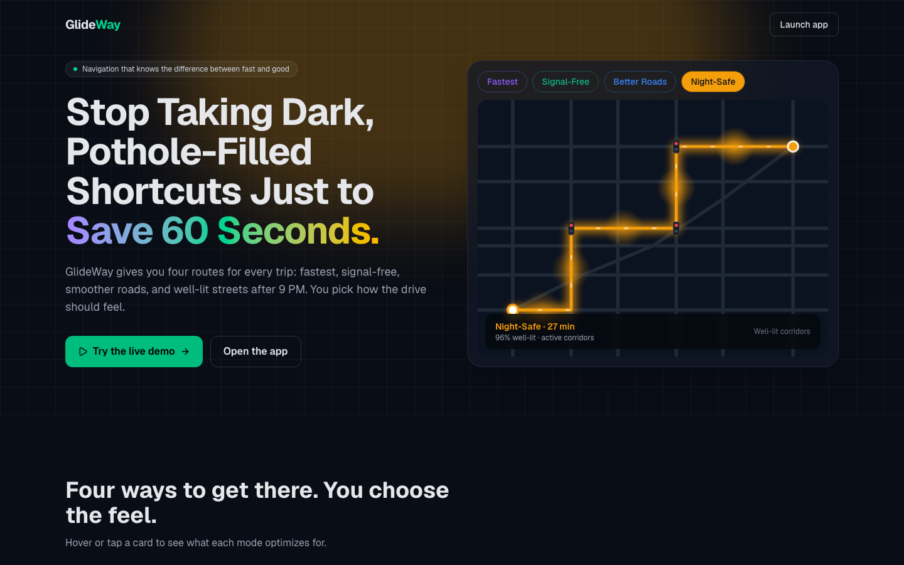
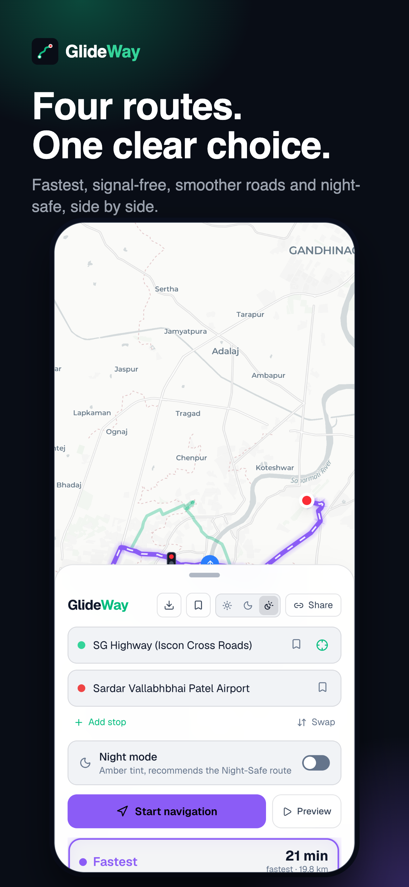
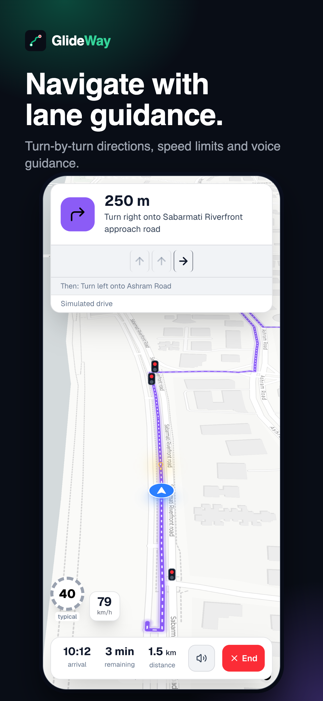
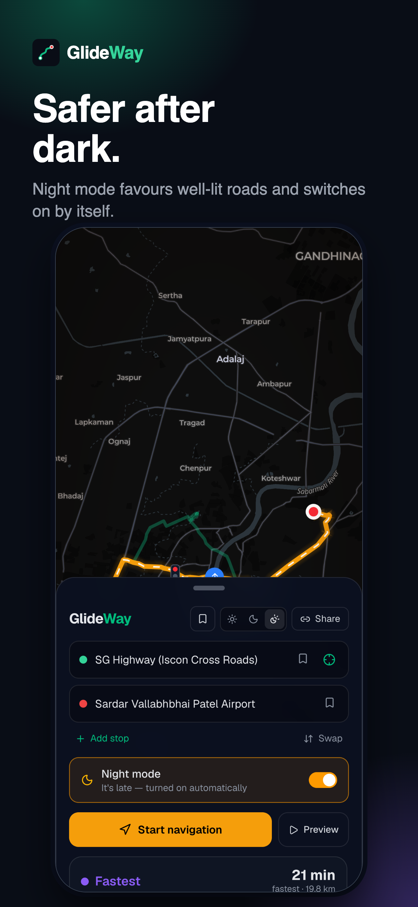
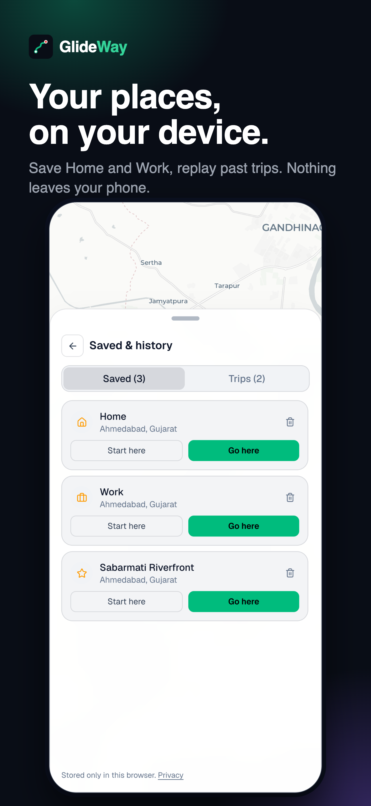
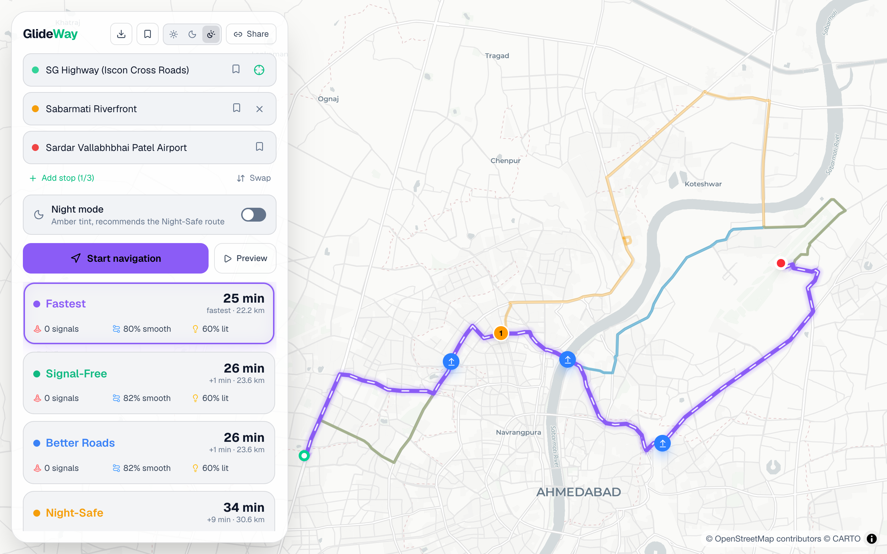
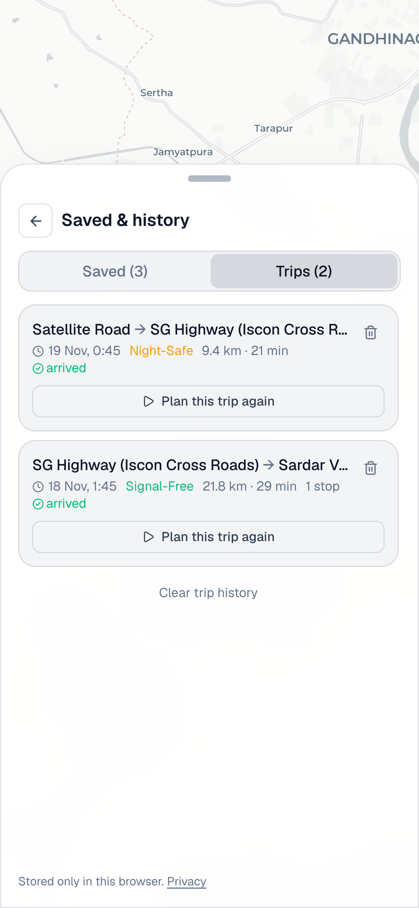

<div align="center">

# GlideWay

**Context-aware navigation that knows the difference between fast and good.**

Four routes for every trip: **Fastest**, **Signal-Free**, **Better Roads** and **Night-Safe**.

[Live demo](https://glideway-web.techguidebro.workers.dev) · [Try the demo route](https://glideway-web.techguidebro.workers.dev/app?demo=1)




</div>

## Screenshots

<p align="center">
  
  
  
  
</p>

| Multi-stop planner (desktop) | Trip history |
| --- | --- |
|  |  |

Store-style graphics live in [`docs/store`](docs/store) and raw captures in [`docs/screenshots`](docs/screenshots).

## Table of contents

- [Overview](#overview)
- [Features](#features)
- [Tech stack](#tech-stack)
- [Getting started](#getting-started)
- [Configuration](#configuration)
- [How routing works](#how-routing-works)
- [Road data pipeline](#road-data-pipeline)
- [Privacy and security](#privacy-and-security)
- [Project structure](#project-structure)
- [Deployment](#deployment)
- [Limitations](#limitations)
- [Data attribution](#data-attribution)

## Overview

Standard navigation optimises for one number: time. GlideWay scores each candidate route on the things drivers actually care about (traffic signals, road surface quality and street lighting) and offers a distinct route for each priority. After 9 PM the app switches to night mode and recommends the Night-Safe route.

Coverage is currently **Gujarat, India** only (see `src/lib/region.ts`).

## Features

| Mode | Optimises for |
| --- | --- |
| **Fastest** | Lowest travel time |
| **Signal-Free** | Fewest traffic signals along the path |
| **Better Roads** | Smoothest surfaces, highest share of well-maintained roads |
| **Night-Safe** | Highest share of lit roads; auto-enabled after 9 PM and before 5 AM |

- **Turn-by-turn directions** for every route, with a step list and manoeuvre icons
- **Live navigation:** GPS-following, heading-up 3D camera, next-turn banner, ETA and remaining distance, voice guidance, screen wake lock, and automatic rerouting when you leave the route
- **Lane guidance and speed limits:** lane arrows before a turn where OpenStreetMap has turn-lane data, a speed-limit sign with your current speed, and an over-limit warning for posted limits. Where no limit is tagged it shows a labelled "typical" value for the road type
- **Saved places and trip history:** Home, Work and favourites, quick picks in the search fields, and a list of past trips you can plan again. All stored on your device
- **Use my location** as the starting point, with a live position dot on the map
- **Multi-stop routes:** up to 3 intermediate stops, scored per leg and joined for each mode
- **Light, dark and auto map themes** (auto is light by day and dark when night mode is on), plus a night mode that adds an amber tint and recommends Night-Safe
- **Installable PWA** with an offline app shell, cached map data and last-known routes
- **Route caching** in memory and on the Cloudflare edge for repeat requests
- Place search with autocomplete (Photon geocoder), swap and demo-route shortcuts
- Per-route metrics: duration, distance, signal count, % smooth, % lit
- Shareable URLs (`/app?from=lng,lat&to=lng,lat&via=lng,lat;lng,lat&mode=…`) and native share on mobile
- Responsive layout: side panel on desktop, draggable bottom sheet on phones
- Honest data handling: where OSM tags are missing, values are estimated from road class and the UI says so

> **Simulated drive:** use **Preview** next to *Start navigation* to replay a route without moving. Real navigation needs HTTPS and location permission.

## Tech stack

- **Framework:** Next.js 15 (App Router), React 19, TypeScript
- **UI:** Tailwind CSS v4, Framer Motion, lucide-react
- **Map:** MapLibre GL via `react-map-gl`
- **Routing:** OSRM (self-hosted or public mirrors)
- **Road data:** OpenStreetMap, from a local tile extract or the Overpass API
- **Hosting:** Cloudflare Workers via `@opennextjs/cloudflare`

## Getting started

**Prerequisites:** Node.js 20+ and npm.

```bash
git clone https://github.com/parthd575/glideway.git
cd glideway
npm install        # postinstall copies the MapLibre worker into public/maplibre
npm run dev        # http://localhost:3000 (landing) and /app (map)
```

Other scripts:

| Command | Description |
| --- | --- |
| `npm run build` | Production build |
| `npm run start` | Serve the production build |
| `npm run lint` | Run ESLint |
| `npm run preview` | Build and preview on the Cloudflare runtime locally |
| `npm run osm:build -- file.osm.pbf` | Build road-data tiles from an OSM extract (needs `osmium`) |
| `npm run osm:sync` | Copy built tiles into `public/osm` so they deploy with the Worker |
| `npm run deploy` | Sync tiles, build and deploy to Cloudflare Workers |

## Configuration

All variables are optional.

| Variable | Description | Default |
| --- | --- | --- |
| `OSRM_URL` | Comma-separated OSRM base URLs, tried in a race | Public OSRM demo and OSM Germany servers |
| `OVERPASS_URLS` | Comma-separated Overpass mirrors | `overpass-api.de`, `overpass.kumi.systems` |
| `OSM_TILES_DIR` | Directory of pre-built OSM tiles | `data/osm-tiles` |
| `NEXT_PUBLIC_SITE_URL` | Base URL for OpenGraph, robots and sitemap | `https://glideway-web.techguidebro.workers.dev` |

For the deployed Worker, `OSRM_URL` is set under `vars` in `wrangler.jsonc`.

## How routing works

The engine lives in `src/lib/routing/` (`osrm.ts` candidates and steps, `overpass.ts` road data, `scoring.ts` metrics and modes, `merge.ts` multi-stop joining).

1. **Candidates.** For each leg, OSRM returns up to three alternatives with turn-by-turn steps. If fewer than four distinct paths exist, detours via perpendicular waypoints are added. With stops, each leg is routed and scored on its own, then the legs are joined per mode.
2. **Road data.** Traffic signals (`highway=traffic_signals`) and road ways (`lit`, `surface`, `smoothness`, `bridge`) near the candidates are loaded from the local OSM extract. If it is unavailable, for example on Workers, one Overpass query over the route bounding box is used, racing all configured mirrors.
3. **Scoring.** Each route is sampled every 40 m. Signals within 20 m are counted (merged within 30 m), and `lit`/`surface` are matched to the nearest way. Missing tags are estimated from road class.
4. **Mode assignment.** Modes are chosen from weighted, min-max normalised scores, preferring distinct paths when they are nearly as good.

`GET /api/route?from=lng,lat&to=lng,lat[&via=lng,lat;lng,lat]` accepts up to 3 `via` stops. Live results are cached for 10 minutes (memory, then the Cloudflare edge cache) and reported in the `X-Route-Cache` header.

The response includes a `source` field:

| `source` | Meaning |
| --- | --- |
| `live` | Scored with real OSM data |
| `partial` | OSM data unavailable; signal, lighting and smoothness values are estimates |
| `sample` | Labelled illustrative data (demo fallback) |

## Road data pipeline

Route scores (signals, lighting, surface, speed limits) come from OpenStreetMap tiles prebuilt from a regional extract, so results do not depend on the rate-limited Overpass API.

```bash
# Download an extract (e.g. from Geofabrik), then:
npm run osm:build -- gujarat-latest.osm.pbf
```

This filters the extract with `osmium`, writes 0.1° JSON tiles to `data/osm-tiles` and copies them to `public/osm`. `npm run deploy` repeats the copy, so the tiles ship with the Worker as static assets and are read through its `ASSETS` binding. Locally, the same tiles are read from disk. If no tiles exist for an area, the engine falls back to Overpass, then to road-class estimates (`source: "partial"`).

Only roads within about 100 m of the candidate routes are indexed per request. The tile size must match in `scripts/build-osm-tiles.mjs` and `src/lib/localOsm.ts`. Extracts and tiles are git-ignored, so rebuild them on any machine that deploys.

**Data caveats.** OSM is community-maintained. In Ahmedabad, roughly 1 in 100 roads has a `maxspeed` tag and only a few dozen have `turn:lanes`, so most limits shown are labelled estimates and lane guidance appears only where it is mapped.

## Project structure

```
src/
  app/
    page.tsx            Landing page
    app/                Map application (AppClient.tsx)
    api/route/route.ts  Routing endpoint
    manifest.ts         PWA manifest
  components/
    landing/            Hero, problem contrast, route showcase, tech flow
    map/                MapCanvas (basemap, routes, markers, navigation camera)
    planner/            RouteSidebar, PlaceInput, RouteCard, DirectionsList, LibraryPanel, toggles
    nav/                NavigationOverlay (turn banner, ETA bar), LaneGuidance
    pwa/                Service worker registration
    ui/                 Shared UI (ManeuverIcon)
  hooks/                useGeolocation, useNavigation, useTheme, usePwaInstall, useSavedPlaces, useTripHistory, useLocationConsent
  lib/
    routing/            OSRM, Overpass, scoring, multi-stop merge
    server/             Route cache (memory + edge)
    navigation.ts       Snap to route, progress, ETA, off-route detection
    directions.ts       Instruction text, icons, distance and time formatting
    shareUrl.ts         Encode and decode shareable URLs
    storage.ts          Local-only storage for saved places, trips and consent
    localOsm.ts         Local OSM tile reader
    photon.ts           Geocoding client
    region.ts           Gujarat bounds and checks
public/                 sw.js (service worker), _headers, offline.html, icons
docs/                   Screenshots and store-style graphics
scripts/                OSM tile builder, MapLibre worker copy
```

## Deployment

The app deploys to Cloudflare Workers with OpenNext:

```bash
npx wrangler login   # first time only
npm run deploy
```

Workers have no local filesystem, so the road-data tiles ship as static assets (`public/osm`, built by `npm run osm:build`). Run that command before `npm run deploy` on a new machine. Routing uses the OSRM endpoints configured in `wrangler.jsonc`.

## Privacy and security

- **Privacy:** no accounts, ads, analytics or cookies. Live GPS stays in the browser; route coordinates are sent to the routing service. Saved places and history are local only. Users are asked before the browser's location prompt, and can delete their data. See [`/privacy`](src/app/privacy/page.tsx).
- **Headers:** `next.config.ts` sets a Content-Security-Policy limited to the app, CARTO map tiles and the Photon geocoder, plus HSTS, `X-Frame-Options: DENY`, `nosniff`, a strict referrer policy, a Permissions-Policy that allows geolocation only for the site, and COOP. `public/_headers` covers static files such as `sw.js`. Scripts still need `'unsafe-inline'` for Next.js bootstrap code; nonces are a follow-up.

## Progressive web app

GlideWay is installable (Chrome, Edge and Android show an install button in the app; on iOS use Share, then Add to Home Screen). The service worker in `public/sw.js` is registered in production only and:

- caches the app shell and static assets, with an offline page for uncached navigations
- caches CARTO basemap styles and tiles (stale-while-revalidate, capped)
- serves the last successful `/api/route` response when offline

Bump `VERSION` in `public/sw.js` to invalidate old caches.

## Limitations

- Coverage is limited to Gujarat; points outside it are rejected.
- Lane guidance and posted speed limits depend on OSM tagging and are sparse; typical limits are estimates.
- Voice guidance uses the browser's speech engine, so voices vary by device. Navigation needs a screen that stays on; browsers pause location updates in the background.
- Navigation instructions come from OSRM manoeuvres and carry no live traffic or lane guidance.
- Public OSRM, Overpass and Photon servers are for light and demo use. Self-host them before serving real traffic.
- Lighting and smoothness depend on OSM tagging quality, which varies by area.

## Data attribution

Map data © [OpenStreetMap contributors](https://www.openstreetmap.org/copyright), basemap © [CARTO](https://carto.com/attributions).
